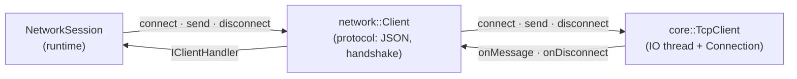
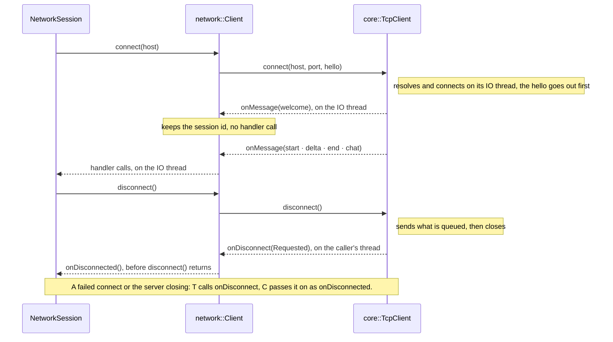

# Network Layer (`netCore`)

This module is the low-level transport layer for the project. It is intentionally small and boring: just TCP sockets with a tiny framing header. The rest of the app (game logic, UI, etc.) treats it as a pipe.

## Big Picture

- `TcpServer` runs an accept loop on a dedicated IO thread.
- Each incoming socket becomes a `Connection`.
- `Connection` handles async read/write and calls back into `TcpServer` via lambdas.
- `TcpClient` connects to a `TcpServer`. Like the server, it runs its I/O on its own thread through a `Connection`.

## Design Choices

- **Simple framing.** We send a small header (`BasicMessageHeader`) that contains payload size, then the payload bytes. This makes parsing very direct and keeps the client/server symmetric.
- **No exceptions on the hot path.** Asio is used with `error_code` overloads so we can return false / empty on failure instead of throwing.
- **Connection lifetime safety.** `Connection` uses `shared_from_this()` and captures `self` in async handlers. This ensures the object stays alive until the handler finishes, which prevents use-after-free when a disconnect happens mid‑IO.
- **Single-threaded write serialization.** We use a strand and a write queue, so multiple calls to `send()` from different threads still serialize into a clean on-wire stream.
- **Lightweight public API.** The public headers are usage-focused and try to stay stable. All heavy details are in cpp files.

## Threading Model

- `TcpServer` and `TcpClient` each run their I/O on their own IO thread (`io_context::run()`).
- `Connection` read/write handlers run on that IO thread and are serialized via the strand.
- Callbacks (`onConnect`, `onMessage`, `onDisconnect`) are invoked from the IO thread, so your handler should be fast or offload work. The one exception is below.
- No `TcpClient` call waits on the network, and all are safe from any thread. `connect()` and `disconnect()` only wait for a callback that is running. `disconnect()` then reports `onDisconnect(Requested)` on its own thread, still one callback at a time; after it returns, no callback of that connection runs.

### Client side

`TcpClient` mirrors `TcpServer`: it owns the IO thread and one `Connection` at a time, and reports back through callbacks. Each layer only talks to its neighbour: calls go down, callbacks come up. No user of `TcpClient` deals with threads or sockets.

## Message framing

Each message is:

1) `BasicMessageHeader` with a 32‑bit payload size (network byte order).  
2) `payload_size` bytes of payload data.

Payload size is bounded by `MAX_PAYLOAD_BYTES`. Oversized payloads are rejected and the connection is closed.

## Common Questions

- **Why shared_ptr for connections?** Because async handlers outlive the stack frame that kicked them off. Keeping a `shared_ptr` prevents a handler from touching a destroyed object.
- **Can I call send() from multiple threads?** Yes, on both sides: it is posted into the strand and queued. On the client, a message sent while connecting waits until the connection is open.
- **Why does TcpClient report the end of a connection inside disconnect()?** So every end is reported exactly once, through one callback, and under the same lock as all other callbacks. Reporting it outside that lock would let it overlap with callbacks of a connection started from it. The destructor ends the connection without a report.

## Where To Look

- `src/net/core/connection.*` for async read/write and lifetime rules.
- `src/net/core/tcpServer.*` for accept loop and connection ownership.
- `src/net/core/tcpClient.*` for the client: connecting, its states, and when callbacks may run.
- `src/net/core/include/network/core/protocol.hpp` for framing constants and byte order helpers.
