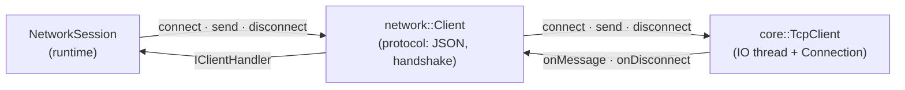
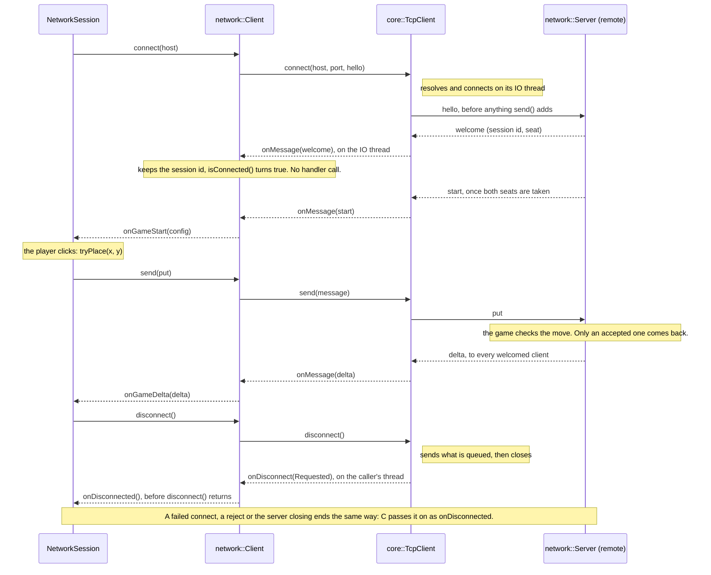

# Game Networking Layer (`netNetwork`)

This module sits between the raw TCP transport (`netCore`) and the game logic.
It turns typed game events into wire messages and back, and it manages server/client roles.

## Big Picture

- **Client**: `network::Client` wraps `core::TcpClient` and handles the protocol; the transport brings its own IO thread.
- **Server**: `network::Server` wraps `core::TcpServer` and exposes a clean event callback.
- **Events**: All wire messages are defined in `nwEvents.hpp` and serialized as JSON.
- **Sessions**: `SessionManager` maps `ConnectionId` <-> `SessionId` and tracks seats.

## Design Choices

- **Small protocol**: JSON is used for clarity and quick iteration. May be improved in the future.
- **Thread split**: server processing is on its own thread; the client handles messages on the IO thread of its `TcpClient` and has no thread of its own.
- **Handshake**: a client's first message is a hello with its protocol version. The server answers with a welcome (session id and seat) or a reject, and ignores everything else until then.

## Client Flow

Each layer only talks to its neighbour: calls go down, callbacks come up. `NetworkSession` never deals with threads, sockets or JSON.

A whole session, with one move:

All handler calls run one at a time: on the IO thread, or `onDisconnected` on the thread that calls `disconnect()`. A handler must never wait for a thread that calls `connect()` or `disconnect()`.

## Server Flow

- Network callbacks only queue events. The server thread handles them in order and is the only one that touches the sessions.
- `send()` and `broadcast()` queue too, so the game may call them from any thread.
- `stop()` queues a shutdown. Everything queued before it still goes out, then the connections close.

## Where To Look

- `src/net/network/include/network/nwEvents.hpp` for the protocol types.
- `src/net/network/nwEvents.cpp` for serialization/parsing.
- `src/net/network/server.*` for the server wrapper and event forwarding.
- `src/net/network/client.*` for the client wrapper and the handshake.
